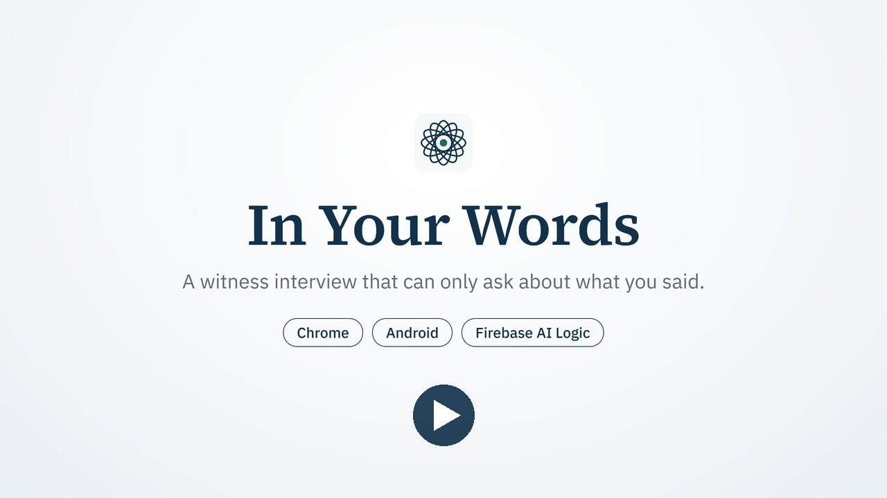
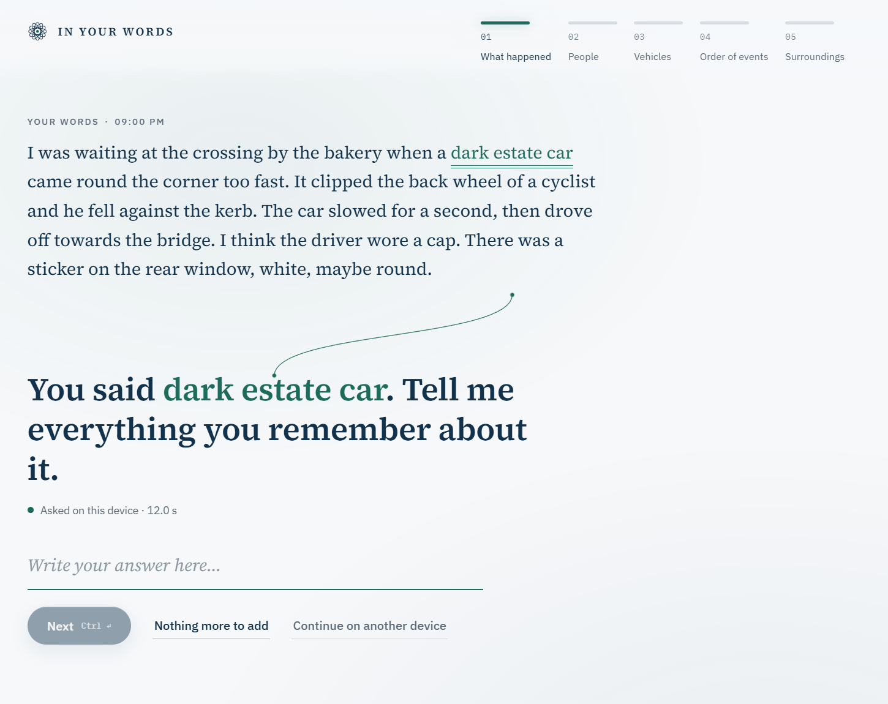
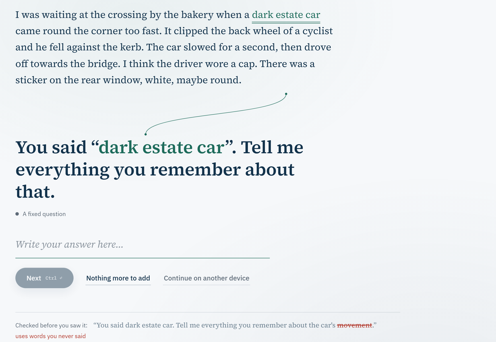
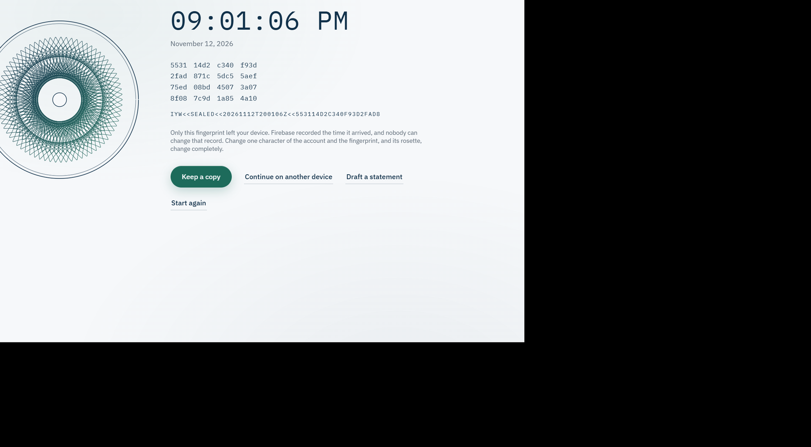
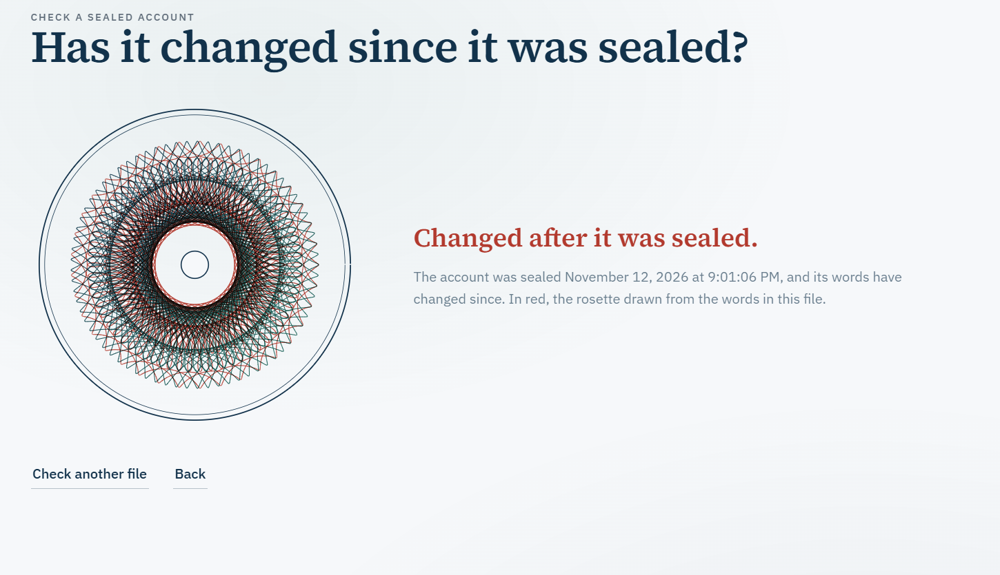
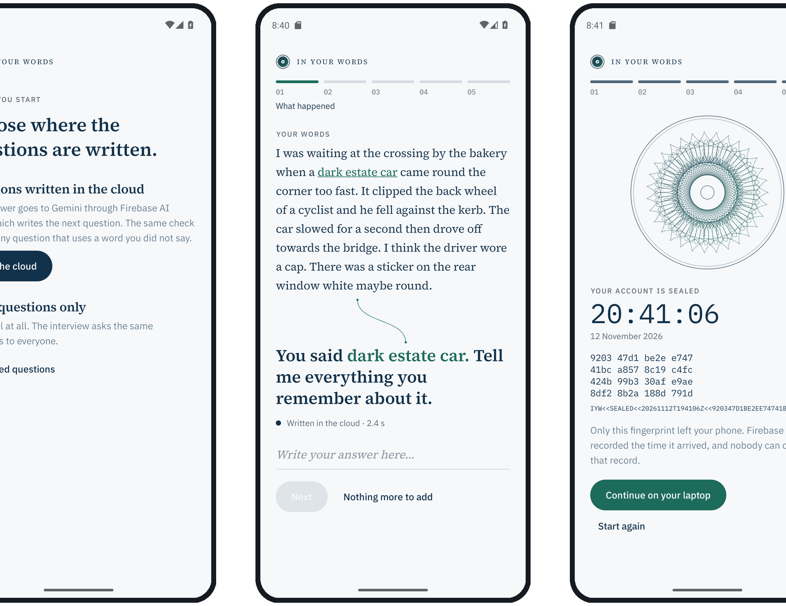
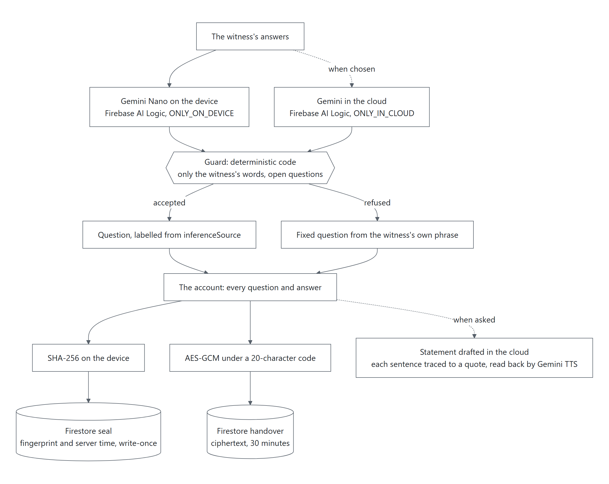

# In Your Words

**A witness interview that can only ask about what you said.**

[](https://github.com/Marc-Dvci/In-Your-Words/actions/workflows/tests.yml)
[](https://github.com/Marc-Dvci/In-Your-Words/actions/workflows/codeql.yml)
[](https://github.com/Marc-Dvci/In-Your-Words/actions/workflows/live.yml)
[](LICENSE)
[](https://in-your-words-2026.web.app)

[](https://youtu.be/6XXSv3leFQE)

**In Your Words helps someone who has just seen something happen record it while it is fresh. Gemini Nano writes
each follow-up question on their device, code refuses any question that uses a word they never said, and a
fingerprint of the account is sealed with a time anyone can check.**

> In audits in the financial sector, a note written on the day counts for more than anything remembered later.
> In Your Words gives a witness that note. (Marc Donovici)

| Live | Platforms | Built with | Headline |
|---|---|---|---|
| [in-your-words-2026.web.app](https://in-your-words-2026.web.app) | Web (Chrome) and Android | Firebase AI Logic hybrid inference, App Check, Firestore, Remote Config, Hosting | Asked plainly, Gemini Nano put a word in the witness's mouth in 79 of 80 follow-ups; with In Your Words, none reached the witness |

[Film](https://youtu.be/6XXSv3leFQE) · [For judges](#for-judges) · [See it work](#see-it-work) · [How it works](#how-it-works) · [Firebase](#how-firebase-is-used) ·
[Results](#results) · [Run it](#run-it)

## For judges

| Criterion | Where it is answered |
|---|---|
| Technological implementation | Hybrid modes and `inferenceSource` in [`web/src/lib/engine.ts`](web/src/lib/engine.ts) and [`android/.../Services.kt`](android/app/src/main/java/app/inyourwords/Services.kt); the guard in [`core/src/guard.ts`](core/src/guard.ts), ported to [Kotlin](android/app/src/main/java/app/inyourwords/core/Guard.kt) and held to [shared vectors](spec/vectors); write-once seals in [`firebase/firestore.rules`](firebase/firestore.rules) |
| Design | [See it work](#see-it-work); the motion is in [`web/src/components`](web/src/components) and [`android/.../ui`](android/app/src/main/java/app/inyourwords/ui); the [browser tests](web/test/e2e/app.spec.ts) check the home, interview and review screens against WCAG 2.2 AA |
| Potential impact | [The problem](#the-problem), and the [evaluation](docs/EVALUATION.md) on 120 descriptions written by real witnesses |
| Quality of the idea | [How it works](#how-it-works): the device model writes, deterministic code decides, and only a fingerprint leaves |

## See it work

[](https://in-your-words-2026.web.app)

<table>
<tr>
<td width="50%"></td>
<td width="50%"></td>
</tr>
<tr>
<td><b>Checked before you saw it.</b> Gemini Nano proposed a question with "movement", a word the witness never used. The guard refused it, and the witness got a fixed question built from their own phrase.</td>
<td><b>The seal.</b> Only the fingerprint left the device. Firestore recorded the time, and the rosette is drawn from the fingerprint itself.</td>
</tr>
<tr>
<td></td>
<td></td>
</tr>
<tr>
<td><b>Verify.</b> One edited answer draws a different rosette, in red over the sealed one.</td>
<td><b>Android.</b> The same interview, guard and seal in Kotlin, tested against the same vectors as the web.</td>
</tr>
</table>

The scene above opens directly at [in-your-words-2026.web.app/?demo#/demo](https://in-your-words-2026.web.app/?demo#/demo).

## The problem

At 18:40, a car clips a cyclist and drives off. The witness on the pavement will give a statement days later, after
talking to other people, reading the news and replaying it in their head. Memory changes in that gap, and questions
change it fastest.

- Asked how fast cars were going when they "smashed" into each other, 32 % of witnesses later remembered broken
  glass that was never there, against 14 % for "hit" (Loftus and Palmer, 1974).
- In 2024, researchers at MIT and Elizabeth Loftus interviewed 200 witnesses of a crime video. A generative chatbot
  raised false memories to 36.4 %, against 10.8 % for the control group[^1].
- Eyewitness misidentification played a part in 69 % of 375 DNA exonerations in the United States[^2].
- The Self-Administered Interview, a booklet a witness fills in alone, was designed to capture an account early
  (Gabbert, Hope and Fisher, 2009). It went digital in June 2026, as the same fixed questions on a screen[^3].

In Your Words is that early account, with follow-up questions that adapt to the witness and can never lead them.

## How it works



1. **Five phases, in the order of the Self-Administered Interview:** what happened, people, vehicles, the events in
   reverse order, surroundings. Each opens with fixed text.
2. **The device writes the follow-up.** Gemini Nano, through Firebase AI Logic in `ONLY_ON_DEVICE` mode, proposes an
   anchor (a phrase the witness used) and one open question about it. The witness's answers stay on the device.
3. **Code decides.** The guard ([`core/src/guard.ts`](core/src/guard.ts)) accepts the question only if every content
   word is one the witness used, and it is not a yes-or-no or either-or question. A refused question is replaced by a
   fixed one built from the witness's own phrase, and stays visible under the interview with its foreign words struck
   through.
4. **Every question says where it came from**, read from the response's `inferenceSource`: on this device, in the
   cloud, a fixed question, or the interview script. The witness's words that a question reuses are tied to it by a
   line.
5. **The seal.** A SHA-256 fingerprint of every question and answer goes to Firestore, which records the server's
   time. The rules make a seal write-once. The rosette drawn on screen is computed from the fingerprint, so one
   changed character draws a different one, and the verify page shows both.
6. **Phone to laptop.** A 20-character code derives a record id and an AES-GCM key with HKDF. The phone stores only
   ciphertext, and the laptop opens it with the code. The code never leaves the screen.
7. **The statement.** When the witness asks, Gemini drafts a first-person statement in which every sentence cites the
   witness's quotes. Code keeps only sentences built from those quotes, and Gemini text-to-speech reads it back.

On a device without Gemini Nano, the witness chooses: questions written in the cloud (`ONLY_IN_CLOUD`), with the same
guard, or fixed questions with no model at all.

## How Firebase is used

| Product | Where | What it does here |
|---|---|---|
| AI Logic, hybrid `ONLY_ON_DEVICE` | [`engine.ts`](web/src/lib/engine.ts), [`Services.kt`](android/app/src/main/java/app/inyourwords/Services.kt) | Gemini Nano writes follow-ups; an on-device failure never falls back to the cloud |
| AI Logic, `ONLY_IN_CLOUD` | the same files | Follow-ups when the witness chooses the cloud |
| AI Logic, `initializeDeviceModel` | [`Setup.tsx`](web/src/screens/Setup.tsx) | Downloads Chrome's model after a click, with progress |
| AI Logic, `inferenceSource` | [`engine.ts`](web/src/lib/engine.ts), [`InterviewParts.tsx`](web/src/components/InterviewParts.tsx) | Labels every question with where it was written |
| AI Logic, structured output | `responseConstraint` on device, `responseSchema` in the cloud | The anchor and question come back as JSON |
| AI Logic, text-to-speech | [`statement.ts`](web/src/lib/statement.ts) | Reads the statement back |
| App Check | [`firebase.ts`](web/src/lib/firebase.ts), [`MainActivity.kt`](android/app/src/main/java/app/inyourwords/MainActivity.kt) | Fraud Defense on the web, the debug provider on Android |
| Firestore and rules | [`store.ts`](web/src/lib/store.ts), [`firestore.rules`](firebase/firestore.rules) | Write-once seals with the server's time; ciphertext handovers that expire |
| Remote Config | [`remoteconfig.template.json`](firebase/remoteconfig.template.json) | The cloud model and the number of follow-ups per phase |
| Hosting | [`firebase.json`](firebase.json) | The live site |

## What it guarantees

- A follow-up question uses only words the witness has used, and is open.
- On a device with Gemini Nano, the interview runs on the device and never falls back to the cloud.
- A seal stores a fingerprint and a time, and nothing else. No one can overwrite it.
- A handover is ciphertext that only the code opens, once, within 30 minutes.
- A drafted statement keeps only sentences built from the witness's quotes.
- The keyboard does not change the witness's words: autocorrect is off in the answer field.

## Results

120 descriptions written by real witnesses after a mock-crime video, each sent to four configurations of the same
Firebase AI Logic model. The held-out 80 were read for the first time by this run. Method and the development set:
[`docs/EVALUATION.md`](docs/EVALUATION.md).

| heldout | Gemini Nano, plain prompt | Gemini cloud, plain prompt | Gemini Nano, In Your Words | Gemini cloud, In Your Words |
|---|---|---|---|---|
| Proposals | 80 | 80 | 80 | 80 |
| Accepted as written | 0 (0 %) | 39 (49 %) | 70 (88 %) | 80 (100 %) |
| Refused: words the witness never used | 79 (99 %) | 1 (1 %) | 6 (8 %) | 0 (0 %) |
| Refused: yes-or-no question | 79 | 40 | 0 | 0 |
| Refused: offers options | 63 | 1 | 2 | 0 |
| Refused: misquotes the witness | 0 | 0 | 0 | 0 |
| Replaced by the anchor question | 47 | 38 | 8 | 0 |
| Replaced by the generic question | 33 | 3 | 2 | 0 |
| Shown to the witness and refused by the guard | 0 | 0 | 0 | 0 |
| Median time per question | 2.5 s | 1.7 s | 2.4 s | 1.6 s |
| 90th percentile | 2.9 s | 4.5 s | 2.8 s | 3.9 s |

- **The risk is real.** Asked plainly for a follow-up, Gemini Nano used a word the witness never said in 79 of 80
  questions, and 79 could be answered yes or no.
- **The instruction does most of the work.** With In Your Words' instruction, 70 of 80 Gemini Nano questions and 80 of
  80 cloud questions passed as written.
- **The guard does the rest.** In every configuration, 0 refused questions reached a witness: each became a fixed
  question built from the witness's own phrase.
- **On-device is fast enough to talk to.** Gemini Nano wrote a question in 2.4 s at the median on this desktop, with
  a 90th percentile of 2.8 s.

Tests: 97 unit tests (core and evaluation) in random order, covering 99.6 % of the core's lines and 97.0 % of its branches, 59 Android unit tests against the shared vectors, and 5
browser tests on the built app with WCAG 2.2 AA checks. Rerun the scoring with `npx vitest run eval`.

Every question in this README and the film was written by Gemini Nano or Gemini through Firebase AI Logic. The
evaluation uses 120 descriptions written by participants of a published eyewitness study (Mickes, 2018, UK Data
Service, CC BY 4.0).

## Run it

> [!TIP]
> No keys needed: `npm ci && npm run dev`, then open http://127.0.0.1:5173/?demo. The demo replays questions recorded
> from real Gemini Nano runs, and keeps seals in the browser.

[](https://codespaces.new/Marc-Dvci/In-Your-Words?quickstart=1)

**Web, with your own Firebase project** (Node 22 or later):

```sh
npm ci
cp web/.env.example web/.env.local      # fill in your web app config and App Check key
npm run dev                             # http://127.0.0.1:5173
npm run build && firebase deploy --only hosting,firestore:rules,remoteconfig
```

On-device inference needs Chrome on a desktop with Gemini Nano: more than 4 GB of VRAM, or 16 GB of RAM, and 22 GB
free. In Firebase, turn on AI Logic with the Gemini Developer API and register the web app in App Check.

**Android** (JDK 17): put your `google-services.json` in `android/app/`, then

```sh
cd android && ./gradlew :app:installDebug
```

On first launch the app prints an App Check debug token in logcat. Add it in the Firebase console under App Check,
Apps, Manage debug tokens.

**Tests:**

```sh
npm test                                # core and evaluation unit tests, in random order, with coverage
npx playwright test                     # browser tests on the built app, with WCAG 2.2 AA checks
cd android && ./gradlew :app:testDebugUnitTest   # the Kotlin core against the shared vectors
```

## Claims and where they are tested

| Claim | Code | Test |
|---|---|---|
| A question with a word the witness never used is refused | [`guard.ts`](core/src/guard.ts) | [`guard.test.ts`](core/test/guard.test.ts), [`GuardVectorsTest.kt`](android/app/src/test/java/app/inyourwords/core/GuardVectorsTest.kt) |
| Yes-or-no and either-or questions are refused | [`guard.ts`](core/src/guard.ts) | [`spec/vectors/guard.json`](spec/vectors/guard.json) |
| The witness only ever sees a question the guard accepts | [`interview.ts`](core/src/interview.ts) `decide()` | [`interview.test.ts`](core/test/interview.test.ts), [`score.test.ts`](eval/score.test.ts) |
| Every label matches the path that served the answer | [`engine.ts`](web/src/lib/engine.ts) | [`score.test.ts`](eval/score.test.ts) |
| Web and Android compute the same fingerprint and rosette | [`seal.ts`](core/src/seal.ts), [`Seal.kt`](android/app/src/main/java/app/inyourwords/core/Seal.kt) | [`seal.test.ts`](core/test/seal.test.ts), [`SealVectorsTest.kt`](android/app/src/test/java/app/inyourwords/core/SealVectorsTest.kt) |
| One changed character is caught at verification | [`Verify.tsx`](web/src/screens/Verify.tsx) | [`app.spec.ts`](web/test/e2e/app.spec.ts) |
| A handover made on one platform opens on the other | [`handover.ts`](core/src/handover.ts), [`Handover.kt`](android/app/src/main/java/app/inyourwords/core/Handover.kt) | [`HandoverVectorsTest.kt`](android/app/src/test/java/app/inyourwords/core/HandoverVectorsTest.kt) |
| A statement keeps only sentences built from quotes | [`trace.ts`](core/src/trace.ts) | [`trace-handover.test.ts`](core/test/trace-handover.test.ts) |

## Layout

```
core/       the shared logic: guard, interview script, seal, rosette, trace, handover (TypeScript)
web/        the web app (Preact, Vite), its evaluation page and browser tests
android/    the Android app (Kotlin, Compose) and the Kotlin port of core/
spec/       vectors both platforms are tested against
eval/       evaluation data, recorded runs, scoring and results
firebase/   Firestore rules and the Remote Config template
docs/       architecture, evaluation, system card
```

Apache-2.0. The evaluation descriptions are © Laura Mickes, CC BY 4.0, from the UK Data Service.

[^1]: Chan, Pataranutaporn, Suri, Zulfikar, Maes and Loftus, "Conversational AI powered by large language models
    amplifies false memories in witness interviews", 2024, [arXiv:2408.04681](https://arxiv.org/abs/2408.04681).
[^2]: Innocence Project, [DNA exonerations in the United States](https://innocenceproject.org/dna-exonerations-in-the-united-states/).
[^3]: University of Portsmouth, [digital Self-Administered Interview](https://www.port.ac.uk/news-events-and-blogs/news/decades-of-memory-science-to-help-preserve-crucial-victim-and-witness-evidence-through-new-digital-partnership), June 2026.
